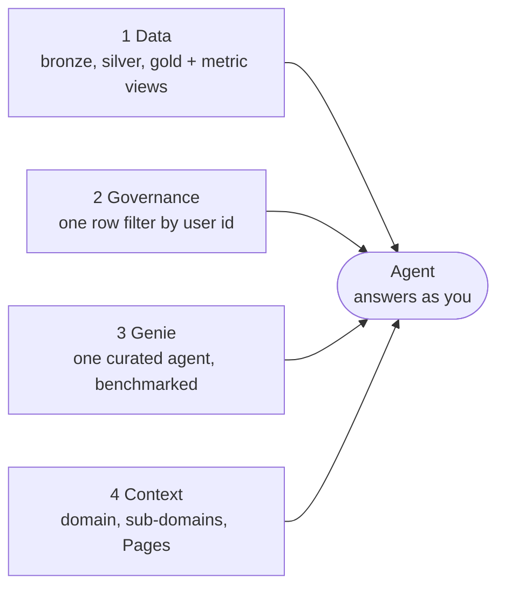

# genie_bootcamp_diggibyte

Hands-on material for **"Genie, Governed: From impressive demo to trusted business application"** (Diggibyte),
in a **simplified** form: three standalone domain samples (Finance, Consumer, Manufacturing). In each one, participants build a
governed lakehouse and a trusted **Genie Agent** on Databricks, with synthetic data for the fictional company
Fjällmark Consumer Goods AB.

It is based on the `bootcamp_domain/` folder of
[`dediggibyte/genie_bootcamp`](https://github.com/dediggibyte/genie_bootcamp). That repository holds the full
two-hour lab: three agents, a router app, and 36 industry-model tables. This one keeps the same steps and notebooks
but cuts each domain down to **4 tables, one row filter, 2 sub-domains and 3 Pages**.

**Start here: [`bootcamp_domain/README.md`](bootcamp_domain/README.md)**, then pick a sample:

| sample | for whom | Genie Agent | business questions |
|---|---|---|---|
| [Finance](bootcamp_domain/finance/README.md) | finance and controlling | Fjällmark Finance Analyst | net revenue, gross margin, DSO |
| [Consumer](bootcamp_domain/consumer/README.md) | e-commerce, CRM | Fjällmark Consumer Analyst | GMV, return rate, active shoppers |
| [Manufacturing](bootcamp_domain/manufacturing/README.md) | plants and operations | Fjällmark Manufacturing Analyst | yield, scrap, downtime |

## Four building blocks feed the agent



| block | step | what is built | notebook |
|---|---|---|---|
| 1 Data | 1-2 | schemas, volume and CSVs in your existing catalog; Lakeflow pipeline bronze → silver → gold; metric views | `01_setup_catalog.py`, bundle `databricks.yml` |
| 2 Governance | 3 | one Unity Catalog row filter on `company_code` (`plant_code` in manufacturing), driven by your user id and a mapping table | `03_governance.py` |
| 3 Genie | 4 | the domain's Genie Agent from a JSON template, with benchmarks | `04_genie_agent.py` |
| 4 Context | 5 | domain and sub-domain tags, Pages from Git, GitHub MCP in Agent mode | `05_business_context.py` |

What each person sees is decided by Unity Catalog at query time, not by the agent: Genie runs every query as the
person who asks.

## Quick start

1. In your Databricks workspace: **Workspace → Create → Git folder** →
   `https://github.com/dediggibyte/genie_bootcamp_diggibyte`.
2. Open `bootcamp_domain/<sample>/01_notebooks/01_setup_catalog.py` → Serverless → **Run all**.
3. Open `bootcamp_domain/<sample>/databricks.yml` → **Deployments** → `dev` → **Deploy**, then run `genie_<sample>_job`.
4. Run notebooks `03_governance`, `04_genie_agent` and `05_business_context`, in that order.
5. When you are done, destroy the bundle and run `99_cleanup`.

Your catalog is already created for you (named after your user, e.g. `labuser123_456`); no step creates a catalog,
and no participant step needs admin rights. Participants skip `00_instructor_setup`.

Instructors: each sample's `00_INSTRUCTOR.md` lists the workspace prerequisites and the one-time domain setup.

## Repository layout

```text
README.md                 this file
bootcamp_domain/
  README.md               overview of the samples, what was simplified, how to run them
  finance/                Finance sample      (Fjällmark Finance Analyst)
  consumer/               Consumer sample     (Fjällmark Consumer Analyst)
  manufacturing/          Manufacturing sample (Fjällmark Manufacturing Analyst)
  tools/build_samples.py  generates the CSV data, manifests and Genie Agent templates
  LICENSE.md, NOTICE.md   Databricks license of the industry data model the table names follow
```

All company names, people, customers and figures are fictional; all data is synthetic.
