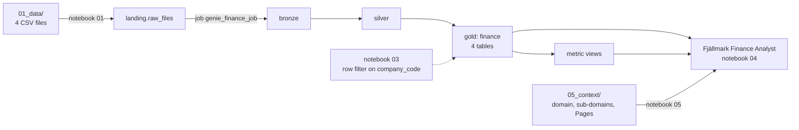

# Genie, Governed: Finance sample (simplified)

A small, self-contained version of the Genie bootcamp lab for **finance and controlling teams**: one catalog, one governed
lakehouse, **one Genie Agent** (the *Fjällmark Finance Analyst*) and the business context of the **Finance** domain. The company
is the fictional Fjällmark Consumer Goods AB; all data is synthetic.

* **The data:** the general ledger of six legal entities (SE01, NO01, DK01, FI01, DE01, PL01) and their B2B receivables, every amount also in EUR. 4 tables, 3,014 rows, January 2025 to September 2026. The CSV
  files ship in [`01_data/`](01_data/).
* **What you build:** catalog `genie_finance_<short name>`, a bronze/silver/gold pipeline, 2
  metric view(s), one row filter on `company_code`, the Fjällmark Finance Analyst with 5 benchmarks, the `Finance` domain tags and
  3 Pages.

Overview of all three samples: [`../README.md`](../README.md). Running it as a workshop: [`00_INSTRUCTOR.md`](00_INSTRUCTOR.md).

---

## Prerequisites

| you need | why |
|---|---|
| this repository as a **Git folder** in your workspace | the notebooks find the data, SQL and templates next to themselves |
| **Serverless** compute for notebooks, jobs and pipelines | every step runs on serverless |
| **CAN USE** on a SQL warehouse | the Genie Agent runs its SQL there |
| your own catalog, or the right to create it | your sandbox |
| the governed tag **Finance** and `ASSIGN` on it | step 5 only; the instructor's [`00_instructor_setup.py`](01_notebooks/00_instructor_setup.py) creates it |
| a GitHub account | step 5: the GitHub MCP signs in with *your* account |

**Your short user name** is the part of your login before `@`, lower case, every character that is not a letter or
digit replaced by `_`: `jane.doe@example.com` → `jane_doe` → catalog `genie_finance_jane_doe`. Every notebook and the
bundle compute it the same way.

**Add the Git folder:** Workspace → your home folder → **Create → Git folder** → URL
`https://github.com/dediggibyte/genie_bootcamp_diggibyte` → **Create Git folder**. A private repository
needs a Git credential first (user icon → Settings → Linked accounts).

---

## The data

| gold table | what it holds | rows |
|---|---|---|
| `finance.company_code` | The six legal entities (company codes) of Fjällmark with their local currency and the fixed EUR rate used in this sample. | 6 |
| `finance.gl_account` | Chart of accounts. account_group decides the P&L line of a posting. | 8 |
| `finance.journal_entry_line` | General-ledger lines (monthly, posted) per company code, account, brand and channel. amount_eur is the P&L amount in EUR: revenue positive, returns and trade discounts negative, costs positive. | 2,538 |
| `finance.ar_invoice` | B2B customer invoices (accounts receivable), status as of the reporting date 2026-09-30. | 462 |

3 foreign keys connect the tables (Genie derives its joins from them). Metric views: `net_revenue_metrics`, `receivables_metrics`.



---

## Step 1: Set up your catalog

Open [`01_notebooks/01_setup_catalog.py`](01_notebooks/01_setup_catalog.py) in your Git folder, attach **Serverless**
and click **Run all**. It creates the catalog (or reuses it), the schemas `landing`, `bronze`, `silver`, `finance`
and `governance`, the volume `landing.raw_files`, and copies the 4 CSV files into it.

| widget | default | meaning |
|---|---|---|
| `catalog` | blank = `genie_finance_<short name>` | the catalog for everything in this sample |
| `managed_location` | blank | storage path for a *new* catalog, only if your metastore needs one |
| `overwrite` | `false` | repairs only |

---

## Step 2: Deploy and run the bundle

1. Open `bootcamp_domain/finance/databricks.yml` in your Git folder.
2. Click **Deployments** (rocket icon), choose target **`dev`**, click **Deploy**.
3. Under **Bundle resources** run the job **`genie_finance_job`**: `pipeline` → `metric_views` → `validate`.

CLI alternative, from `bootcamp_domain/finance/`:

```bash
databricks bundle deploy -t dev        # add --var catalog=<name> if you used another catalog in step 1
databricks bundle run genie_finance_job -t dev
```

The pipeline keeps every column as text in **bronze**, types and de-duplicates in **silver**, and builds the
**gold** tables with comments, primary and foreign keys. **Never click *Full refresh*.** If the very first update
shows *"FAILED unexpectedly"* while it registers the foreign keys, the automatic retry finishes it.

---

## Step 3: Governance

Right now everyone who can read your gold tables sees every company code. Open
[`01_notebooks/03_governance.py`](01_notebooks/03_governance.py), keep the defaults and click **Run all**.

The notebook takes **your user id** (`current_user()`), writes it with the company codes you may see into the
mapping table `governance.user_company_access`, and attaches **one row filter**, `governance.company_filter`, to the
`company_code` column of `finance.journal_entry_line`, `finance.ar_invoice`. Nothing else is filtered or masked.

| widget | default | meaning |
|---|---|---|
| `catalog` | blank | your catalog |
| `company_code` | `SE01` | the company codes **you** may see: `SE01`, `SE01,NO01` or `ALL` |
| `rollback` | `false` | **leave it `false`**, or the filter is removed again |

The filter is attached with `ALTER MATERIALIZED VIEW ... SET ROW FILTER ... ON (company_code)` (the gold
tables are pipeline materialized views); the metric views and Genie inherit it. To see more or less, change the
widget and run again - the mapping is data, not code, and no pipeline run is needed.

**Expected result:** gold shows only your company codes, all checks PASS; re-running reports `unchanged`.

> Members of the account group `cpg_bootcamp_admins` bypass the filter. Test as a non-admin.

---

## Step 4: The Genie Agent

Open [`01_notebooks/04_genie_agent.py`](01_notebooks/04_genie_agent.py) and click **Run all**. It creates
**Fjällmark Finance Analyst (\<catalog\>)** in your home folder from
[`04_genie/fjallmark_finance_analyst.json`](04_genie/fjallmark_finance_analyst.json), asks a test question through
the Conversation API and runs the 5 benchmarks with the evaluation API.

| widget | default | meaning |
|---|---|---|
| `catalog` | blank | your catalog |
| `warehouse` | blank = first serverless warehouse you can use | the agent's SQL warehouse |
| `ask_test_question` / `run_benchmarks` | `true` | steps 5 and 6 |
| `force_update` | `false` | `true` overwrites your UI edits with the template |

Expected benchmark answers **for a user who sees everything** (with the step 3 defaults you see only your rows):

| benchmark | expected |
|---|---|
| What was total net revenue in 2025? | EUR 44.2 m |
| What is the gross margin % by brand in 2026? | Kallkälla ≈ 49.9 %, Björkö Pantry ≈ 43.6 %, Mjuk Care ≈ 40.0 % |
| What was COGS of PL01 by month in Q1 2026? | Jan ≈ EUR 141 k, Feb ≈ EUR 139 k, Mar ≈ EUR 281 k |
| What is the DSO of DE01? | ≈ 72 days (group ≈ 43) |
| How much overdue AR is there per company code? | EUR 1.0 m in total; DE01 ≈ EUR 557 k |

Questions about another domain are declined by design: the agent names the Fjällmark analyst that answers them.

---

## Step 5: Business context

The domain, its sub-domains and the Pages live in [`05_context/`](05_context/):

| sub-domain tag | tables | metric view |
|---|---|---|
| `Finance/General Ledger` | company_code, gl_account, journal_entry_line | `net_revenue_metrics` |
| `Finance/Receivables Payables` | ar_invoice | `receivables_metrics` |

Pages: Net Revenue, Gross Margin, DSO ([`05_context/pages/`](05_context/pages/), index [`glossary.csv`](05_context/glossary.csv)).

1. **Tags (notebook):** [`01_notebooks/05_business_context.py`](01_notebooks/05_business_context.py) tags the
   `finance` schema with the domain `Finance`, every table and metric view with its sub-domain, and your agent.
   Without the governed tags (instructor step) it skips the tags and carries on.
2. **Pages (UI):** the notebook prints a **Bulk import pages** prompt. Discover → Pages → Create page → Genie Code →
   **Bulk import pages**, attach the two paths it prints, paste the prompt. The Pages are created as drafts.
3. **GitHub MCP (UI):** on the agent's Sources, add `system.ai.github` with the description the notebook prints,
   switch on **Agent mode** and ask: *"According to our glossary, how is DSO defined - and what is DE01's DSO?"*

---

## Troubleshooting

| symptom | fix |
|---|---|
| Notebook 01: "databricks.yml not found" | open the notebook from the Git folder |
| Notebook 01: the catalog cannot be created | create it in Catalog → **+** → Create a catalog, or set `managed_location` |
| Pipeline "FAILED unexpectedly" on the first run | expected once; the retry registers the keys. Never use *Full refresh* |
| `validate` fails on foreign keys or row counts | run the job again; it loads nothing twice |
| Notebook 03 or 04: tables missing | wait until `genie_finance_job` is green |
| You still see everything after notebook 03 | you are in `cpg_bootcamp_admins`, set the widget to `ALL`, or `rollback = true` |
| Notebook 05: governed tags missing | the instructor has not run `00_instructor_setup.py`; Pages and MCP still work |

---

## Cleanup

1. Run [`01_notebooks/99_cleanup.py`](01_notebooks/99_cleanup.py) once: it lists what it would delete.
2. Type your catalog name into `confirm` and **Run all** again (agent to the trash, row filter, catalog).
3. Destroy the bundle: Deployments → **Destroy**, or `databricks bundle destroy -t dev` from this folder.

Account-level objects (the domain, governed tags, published Pages) are never touched.

---

## What is in this folder

```text
finance/
  README.md, 00_INSTRUCTOR.md      this guide, and the instructor guide
  01_data/                         4 CSV files + manifest.json (generated)
  01_notebooks/                    00 instructor setup, 01, 03-05, 99, job_tasks/02a-02b
  databricks.yml, resources/       step 2: the bundle (pipeline + job)
  02_pipeline/                     bronze, silver, gold SQL
  02_metric_views/                 `net_revenue_metrics`, `receivables_metrics`
  04_genie/                        the Genie Agent template (generated)
  05_context/                      domain, 2 sub-domains, 3 Pages, glossary.csv
```

Generated files come from [`../tools/build_samples.py`](../tools/build_samples.py); everything else is hand-written.
