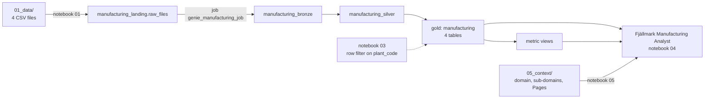

# Genie, Governed: Manufacturing sample (simplified)

A small, self-contained version of the Genie bootcamp lab for **plant, operations and production-controlling teams**: your catalog, one governed
lakehouse, **one Genie Agent** (the *Fjällmark Manufacturing Analyst*) and the business context of the **Manufacturing** domain. The company
is the fictional Fjällmark Consumer Goods AB; all data is synthetic.

* **The data:** four plants (Lund and Norrköping in Sweden, Tampere in Finland, Poznań in Poland), their 12 lines, production orders and line downtime. 4 tables, 2,302 rows, January 2025 to September 2026. The CSV
  files ship in [`01_data/`](01_data/).
* **What you build:** in your existing catalog, the schemas `manufacturing*`, a bronze/silver/gold pipeline, 1
  metric view(s), one row filter on `plant_code`, the Fjällmark Manufacturing Analyst with 5 benchmarks, the `Manufacturing` domain tags and
  3 Pages.

Overview of all three samples: [`../README.md`](../README.md). Running it as a workshop: [`00_INSTRUCTOR.md`](00_INSTRUCTOR.md).

---

## Prerequisites

| you need | why |
|---|---|
| this repository as a **Git folder** in your workspace | the notebooks find the data, SQL and templates next to themselves |
| **Serverless** compute for notebooks, jobs and pipelines | every step runs on serverless |
| **CAN USE** on a SQL warehouse | the Genie Agent runs its SQL there |
| **your own catalog**, already created for you (e.g. `labuser123_456`) | your sandbox; the notebooks never create a catalog |
| the governed tag **Manufacturing** and `ASSIGN` on it | step 5 only, optional; the instructor's [`00_instructor_setup.py`](01_notebooks/00_instructor_setup.py) creates it. **Participants never run notebook 00** (it needs admin rights) |
| a GitHub account | step 5: the GitHub MCP signs in with *your* account |

**Your short user name** is the part of your login before `@`, lower case, every character that is not a letter or
digit replaced by `_`: `labuser123_456@vocareum.com` → catalog `labuser123_456`. Every notebook and the bundle use
it as the default catalog; if yours is named differently, type it into each notebook's `catalog` widget and deploy the
bundle with `--var catalog=<name>`.

The sample only creates schemas that start with its name - `manufacturing` (gold), `manufacturing_landing`, `manufacturing_bronze`,
`manufacturing_silver` and `manufacturing_governance` - so all three samples can share your catalog.

**Add the Git folder:** Workspace → your home folder → **Create → Git folder** → URL
`https://github.com/dediggibyte/genie_bootcamp_diggibyte` → **Create Git folder**. A private repository
needs a Git credential first (user icon → Settings → Linked accounts).

---

## The data

| gold table | what it holds | rows |
|---|---|---|
| `manufacturing.plant` | The four plants of Fjällmark. | 4 |
| `manufacturing.production_line` | Production lines, three per plant, named <plant>-L<n>. | 12 |
| `manufacturing.production_order` | Production orders: one product on one line, with plan, actuals, quantities and cost. Only completed orders count for yield, scrap and on-time KPIs. | 1,441 |
| `manufacturing.downtime_event` | Line stops during completed production orders, with reason and duration. | 845 |

4 foreign keys connect the tables (Genie derives its joins from them). Metric views: `production_metrics`.



---

## Step 1: Set up your catalog

Open [`01_notebooks/01_setup_catalog.py`](01_notebooks/01_setup_catalog.py) in your Git folder, attach **Serverless**
and click **Run all**. It checks that your catalog exists (it never creates one), creates the schemas `manufacturing`,
`manufacturing_landing`, `manufacturing_bronze`, `manufacturing_silver` and `manufacturing_governance`, the volume
`manufacturing_landing.raw_files`, and copies the 4 CSV files into it.

| widget | default | meaning |
|---|---|---|
| `catalog` | blank = `<your short user name>` | your existing catalog |
| `overwrite` | `false` | repairs only |

---

## Step 2: Deploy and run the bundle

1. Open `bootcamp_domain/manufacturing/databricks.yml` in your Git folder.
2. Click **Deployments** (rocket icon), choose target **`dev`**, click **Deploy**.
3. Under **Bundle resources** run the job **`genie_manufacturing_job`**: `pipeline` → `metric_views` → `validate`.

CLI alternative, from `bootcamp_domain/manufacturing/`:

```bash
databricks bundle deploy -t dev        # add --var catalog=<name> if you used another catalog in step 1
databricks bundle run genie_manufacturing_job -t dev
```

The pipeline keeps every column as text in **bronze**, types and de-duplicates in **silver**, and builds the
**gold** tables with comments, primary and foreign keys. **Never click *Full refresh*.** If the very first update
shows *"FAILED unexpectedly"* while it registers the foreign keys, the automatic retry finishes it.

---

## Step 3: Governance

Right now everyone who can read your gold tables sees every plant. Open
[`01_notebooks/03_governance.py`](01_notebooks/03_governance.py), keep the defaults and click **Run all**.

The notebook takes **your user id** (`current_user()`), writes it with the plants you may see into the
mapping table `manufacturing_governance.user_plant_access`, and attaches **one row filter**, `manufacturing_governance.plant_filter`, to the
`plant_code` column of `manufacturing.production_order`, `manufacturing.downtime_event`. Nothing else is filtered or masked.

| widget | default | meaning |
|---|---|---|
| `catalog` | blank | your catalog |
| `plant_code` | `SE-LUN` | the plants **you** may see: `SE-LUN`, `SE-LUN,PL-POZ` or `ALL` |
| `rollback` | `false` | **leave it `false`**, or the filter is removed again |

The filter is attached with `ALTER MATERIALIZED VIEW ... SET ROW FILTER ... ON (plant_code)` (the gold
tables are pipeline materialized views); the metric views and Genie inherit it. To see more or less, change the
widget and run again - the mapping is data, not code, and no pipeline run is needed.

**Expected result:** gold shows only your plants, all checks PASS; re-running reports `unchanged`.

> Members of the account group `cpg_bootcamp_admins` bypass the filter. Test as a non-admin.

---

## Step 4: The Genie Agent

Open [`01_notebooks/04_genie_agent.py`](01_notebooks/04_genie_agent.py) and click **Run all**. It creates
**Fjällmark Manufacturing Analyst (\<catalog\>)** in your home folder from
[`04_genie/fjallmark_manufacturing_analyst.json`](04_genie/fjallmark_manufacturing_analyst.json), asks a test question through
the Conversation API and runs the 5 benchmarks with the evaluation API.

| widget | default | meaning |
|---|---|---|
| `catalog` | blank | your catalog |
| `warehouse` | blank = first serverless warehouse you can use | the agent's SQL warehouse |
| `ask_test_question` / `run_benchmarks` | `true` | steps 5 and 6 |
| `force_update` | `false` | `true` overwrites your UI edits with the template |

Expected benchmark answers **for a user who sees everything** (with the step 3 defaults you see only your rows):

| benchmark | expected |
|---|---|
| What is the yield % per plant in 2026? | 97.6-98.3 % in every plant |
| What was the scrap rate of line PL-POZ-L2 in March 2026? | 9.6 % (1.6 % in February) |
| What is the on-time completion rate per plant? | 87-93 % per plant (SE-LUN highest) |
| Which downtime reason caused the most minutes on PL-POZ-L2 in March 2026? | mechanical_failure (≈ 58 hours) |
| How many production orders were completed per plant in 2025? | SE-LUN 206, SE-NKP 201, PL-POZ 201, FI-TMP 166 (started April 2025) |

Questions about another domain are declined by design: the agent names the Fjällmark analyst that answers them.

---

## Step 5: Business context

The domain, its sub-domains and the Pages live in [`05_context/`](05_context/):

| sub-domain tag | tables | metric view |
|---|---|---|
| `Manufacturing/Asset Configuration` | plant, production_line | - |
| `Manufacturing/Batch Execution` | production_order, downtime_event | `production_metrics` |

Pages: Plant, Yield, Downtime ([`05_context/pages/`](05_context/pages/), index [`glossary.csv`](05_context/glossary.csv)).

1. **Tags (notebook):** [`01_notebooks/05_business_context.py`](01_notebooks/05_business_context.py) tags the
   `manufacturing` schema with the domain `Manufacturing`, every table and metric view with its sub-domain, and your agent.
   Without the governed tags (instructor step) it skips the tags and carries on.
2. **Pages (UI):** the notebook prints a **Bulk import pages** prompt. Discover → Pages → Create page → Genie Code →
   **Bulk import pages**, attach the two paths it prints, paste the prompt. The Pages are created as drafts.
3. **GitHub MCP (UI):** on the agent's Sources, add `system.ai.github` with the description the notebook prints,
   switch on **Agent mode** and ask: *"According to our glossary, how is yield defined - and why did scrap spike in Poznań in March 2026?"*

---

## Troubleshooting

| symptom | fix |
|---|---|
| Notebook 01: "databricks.yml not found" | open the notebook from the Git folder |
| Notebook 01: "Catalog ... not found" | find your catalog in Catalog → *My organization* and type its name into the `catalog` widget (and `--var catalog=<name>` for the bundle) |
| Notebook 01: no permission to create a schema | ask the instructor for `USE CATALOG` and `CREATE SCHEMA` on your catalog |
| Pipeline "FAILED unexpectedly" on the first run | expected once; the retry registers the keys. Never use *Full refresh* |
| `validate` fails on foreign keys or row counts | run the job again; it loads nothing twice |
| Notebook 03 or 04: tables missing | wait until `genie_manufacturing_job` is green |
| You still see everything after notebook 03 | you are in `cpg_bootcamp_admins`, set the widget to `ALL`, or `rollback = true` |
| Notebook 05: governed tags missing | the instructor has not run `00_instructor_setup.py`; Pages and MCP still work |

---

## Cleanup

1. Destroy the bundle: Deployments → **Destroy**, or `databricks bundle destroy -t dev` from this folder.
2. Run [`01_notebooks/99_cleanup.py`](01_notebooks/99_cleanup.py) once: it lists what it would delete.
3. Type your catalog name into `confirm` and **Run all** again: your agent goes to the trash and this sample's five
   schemas are dropped. **Your catalog and the other samples' schemas are kept.**

Account-level objects (the domain, governed tags, published Pages) are never touched.

---

## What is in this folder

```text
manufacturing/
  README.md, 00_INSTRUCTOR.md      this guide, and the instructor guide
  01_data/                         4 CSV files + manifest.json (generated)
  01_notebooks/                    00 instructor setup, 01, 03-05, 99, job_tasks/02a-02b
  databricks.yml, resources/       step 2: the bundle (pipeline + job)
  02_pipeline/                     bronze, silver, gold SQL
  02_metric_views/                 `production_metrics`
  04_genie/                        the Genie Agent template (generated)
  05_context/                      domain, 2 sub-domains, 3 Pages, glossary.csv
```

Generated files come from [`../tools/build_samples.py`](../tools/build_samples.py); everything else is hand-written.
